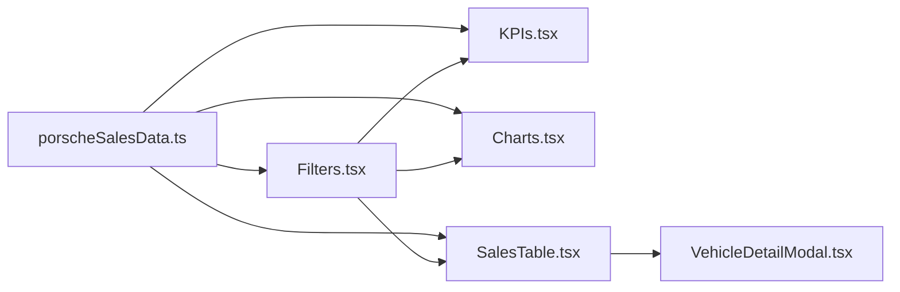

# dashboard-vendas-porsche-dio

**English** · [Português (Brasil)](README.md)

[](#)
[](#)
[](#)
[](#)
[](#)
[](LICENSE)

## What it is

**Porsche sales dashboard** with mock data, interactive charts (Recharts), KPI cards, filters, and a detail modal. Includes a rule-based AI analysis (offline, deterministic). Bootcamp DIO project.

## Status

Working. Clean build (vite build). No automated tests.

## Features

- **KPIs**: total revenue, average ticket, top-selling models, revenue by period.
- **Charts**: sales by month, model distribution, state heatmap.
- **Filters**: by period, model, state, payment method, delivery status.
- **Sales table**: sortable and searchable listing.
- **Detail modal**: full sale record view.
- **AI analysis**: rule-generated insights (`getAIResponse`) — trends, anomalies, invalid data flags.

## Architecture

React SPA with components in `src/components/` and mock data in `src/data/`. State management uses `useState` + `useMemo` (no Context API). Mock data as inline TypeScript constants.



## Stack

- TypeScript 5.x, React 18, Vite 5
- Tailwind CSS 3, Recharts 2
- `lucide-react` (icons), `motion` (animations)

## Repository layout

```
dashboard-vendas-porsche-dio/
├── index.html
├── vite.config.ts
├── src/
│   ├── main.tsx              # entry point
│   ├── App.tsx               # main component + global state
│   ├── data/
│   │   └── porscheSalesData.ts  # mock data + PorscheSale interface
│   └── components/
│       ├── KPIs.tsx           # KPI cards
│       ├── Charts.tsx         # Recharts charts
│       ├── Filters.tsx        # period/model/status filters
│       ├── SalesTable.tsx     # sales data table
│       └── VehicleDetailModal.tsx  # detail modal
├── README.md / README.en.md
└── LICENSE (MIT)
```

## Prerequisites and installation

Node.js 18+.

```bash
npm install
```

## How to run

```bash
npm run dev     # development server (port 3000)
npm run build   # production build (single inline HTML)
```

## Tests and quality

No automated tests yet.

Build verified:

```bash
npm run build
# dist/index.html  89.98 kB | gzip: 20.87 kB
```

## Technical decisions and trade-offs

- **Inline mock data**: rapid prototyping without a backend; static data in exchange.
- **useState + useMemo state**: avoids Context/Redux complexity for this app size.
- **Rule-based AI**: `getAIResponse()` is offline and deterministic -- no API cost, but limited to predefined patterns.
- **Single-file build**: Vite `vite:singlefile` plugin produces a single HTML -- simpler deployment.

## Known limitations and roadmap

- No automated tests.
- Mock data -- replace with a real API for production.
- AI analysis is rule-based, not generative.
- No authentication or persistence.

## Development process

An individual project by Kelvin Oliveira for the DIO bootcamp, built with orchestrated AI agents and reviewed by the author. The dashboard and analysis are the author's.

## License and author

MIT -- Copyright (c) 2026 Kelvin Rebelo de Oliveira.

**Author**: [Kelvin Oliveira](https://github.com/KelvinOliveiraCode) · [Portfolio](https://kelvinoliveiracode.github.io/portfolio/)