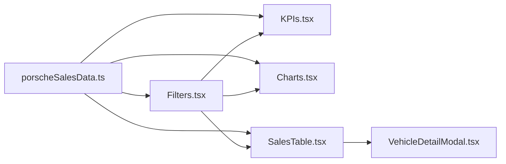

# dashboard-vendas-porsche-dio

[English](README.en.md) · **Português (Brasil)**

[](#)
[](#)
[](#)
[](#)
[](#)
[](LICENSE)

## O que e

**Dashboard de vendas Porsche** com dados mock, graficos interativos (Recharts), KPI cards, filtros e um modal de detalhes. Inclui analises por IA baseada em regras (offline, deterministica). Projeto do bootcamp DIO.

## Status

Funcional. Build limpa (vite build). Nenhum teste automatizado.

## Funcionalidades

- **KPIs**: total vendido, ticket medio, carros mais vendidos, receita por periodo.
- **Graficos**: vendas por mes, distribuicao por modelo, mapa de calor por estado.
- **Filtros**: por periodo, modelo, estado, metodo de pagamento, status de entrega.
- **Tabela de vendas**: listagem com busca e ordenacao.
- **Modal de detalhes**: visualizacao completa de cada venda.
- **Analise IA**: insights gerados por regras (`getAIResponse`) — tendencias, anomalias, dados invalidados.

## Arquitetura

SPA React com componentes em `src/components/` e dados mock em `src/data/`. Toda a logica de estado usa `useState` + `useMemo` (sem Context API). Dados mock inline como constantes TypeScript.



## Stack

- TypeScript 5.x, React 18, Vite 5
- Tailwind CSS 3, Recharts 2
- `lucide-react` (icones), `motion` (animacoes)

## Estrutura do repositorio

```
dashboard-vendas-porsche-dio/
├── index.html
├── vite.config.ts
├── src/
│   ├── main.tsx              # entrada
│   ├── App.tsx               # componente principal + estado global
│   ├── data/
│   │   └── porscheSalesData.ts  # dados mock + interface PorscheSale
│   └── components/
│       ├── KPIs.tsx           # cartoes de indicadores
│       ├── Charts.tsx         # graficos Recharts
│       ├── Filters.tsx        # filtros de periodo/modelo/status
│       ├── SalesTable.tsx     # tabela de vendas
│       └── VehicleDetailModal.tsx  # modal de detalhes
├── README.md / README.en.md
└── LICENSE (MIT)
```

## Pre-requisitos e instalacao

Node.js 18+.

```bash
npm install
```

## Como executar

```bash
npm run dev     # servidor de desenvolvimento (porta 3000)
npm run build   # build de producao (HTML inline unico)
```

## Testes e qualidade

Nenhum teste automatizado ate o momento.

Build verificada:

```bash
npm run build
# dist/index.html  89.98 kB │ gzip: 20.87 kB
```

## Decisoes tecnicas e trade-offs

- **Dados mock inline**: prototipagem rapida sem backend; em troca, dados estaticos.
- **Estado com useState + useMemo**: evita complexidade de Context/Redux para um app deste tamanho.
- **IA baseada em regras**: `getAIResponse()` e offline e deterministica — sem custo de API, mas limitada a padroes pre-definidos.
- **Build single-file**: Vite plugin `vite:singlefile` produz um unico HTML — deploy simplificado.

## Limitacoes conhecidas e roadmap

- Sem testes automatizados.
- Dados mock — substituir por API real para uso em producao.
- A analise IA e rule-based, nao generativa.
- Sem autenticacao ou persistencia.

## Processo de desenvolvimento

Projeto individual de Kelvin Oliveira para o bootcamp DIO, construido com agentes de IA orquestrados e revisado pelo autor. O dashboard e a analise sao do autor.

## Licenca e autor

MIT — Copyright (c) 2026 Kelvin Rebelo de Oliveira.

**Autor**: [Kelvin Oliveira](https://github.com/KelvinOliveiraCode) · [Portfolio](https://kelvinoliveiracode.github.io/portfolio/)